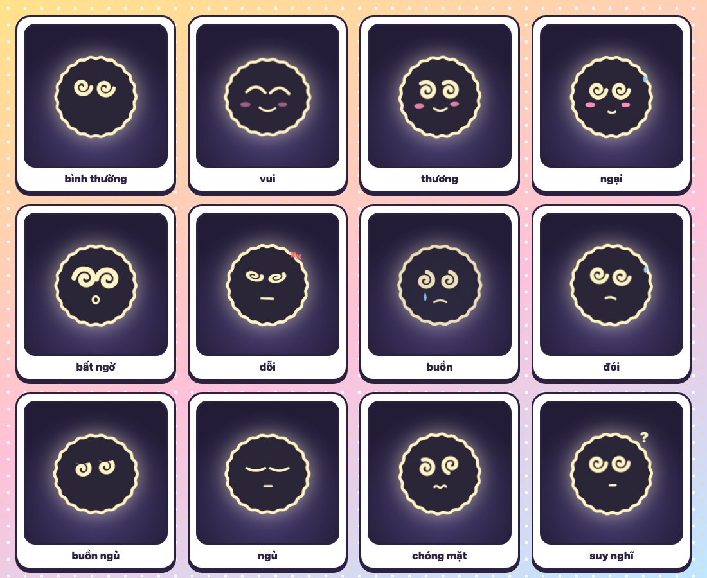

# AICoworker Gadgets

Hold a button on a pocket-size board, talk, and hear **your own AICoworker
agent** answer — at home over Wi-Fi, or from anywhere through the AICW relay.

<p align="center"></p>

The gadget wears **Dou**, the AICW mascot: a round dark body with a glowing
scalloped rim and spiral eyes. It hatches from an egg when it boots, listens
with wide eyes, thinks with a "?", taps away while it works, talks with its
mouth in time with the voice, gets dizzy on errors, falls asleep when idle,
and blushes with hearts when you pet it.

## What is in here

| Path | What |
|---|---|
| `esp32/` | ESP32 firmware (ESP-IDF 6.0). Tested on the **M5Stack StickS3**; the other board configs from the upstream SDK are kept but unverified |
| `esp32/components/dou/aicw_*` | The AICW transport: push-to-talk over LAN WebSocket or over the AICW relay with end-to-end encryption |
| `esp32/avatar/dou_pixel.c` | Dou, the procedural 64×64 pixel-art avatar |
| `bridge/` | The PC side: speech-to-text, your AICoworker agent, text-to-speech |
| `docs/` | [Research notes](docs/RESEARCH.md), [device protocol](docs/PROTOCOL.md), [Dou's faces](docs/DOU-FACES.md) |
| `scripts/` | Build/flash and the serial setup helper |
| `tools/rebrand.py` | The script that turned the upstream SDK into this one (re-run it after merging upstream) |

## Quick start (M5Stack StickS3)

1. **PC side.** On the computer that runs AICoworker, enable a sharedwebchat
   account for your agent, then:
   ```sh
   cd bridge
   python3 -m venv .venv && . .venv/bin/activate
   pip install websockets requests numpy faster-whisper edge-tts imageio-ffmpeg cryptography
   AICW_CHAT_BASE=http://127.0.0.1:23336/webchat/<account> \
   AICW_ALLOWED_MACS=<your stick's wifi mac> \
   python3 bridge.py
   ```
   It prints its **relay hostId**. Keep it private: whoever knows it can reach
   your bridge (that is what `AICW_ALLOWED_MACS` is for).
2. **Firmware.** Install ESP-IDF 6.0, plug in the stick, then:
   ```sh
   scripts/build-sticks3.sh flash
   ```
3. **Setup over USB.**
   ```sh
   pip install pyserial
   python3 scripts/stick.py wifi                       # asks SSID + password
   python3 scripts/stick.py host relay:<hostId>        # or 192.168.x.y:8765 on the same LAN
   python3 scripts/stick.py status
   ```
4. Hold the button, talk, release. Dou answers.

No hardware yet? `python3 bridge/fake_stick.py --relay <hostId> --say "xin chào"`
plays the device side from your computer.

## Credits

AICoworker Gadgets is built on the **[Muse Gadget SDK](https://github.com/facebookincubator/muse-gadget-sdk)
by Meta** — we used it as the reference and starting point for the device
firmware (boards, display, audio, Wi-Fi, push-to-talk, console). Thank you to
its authors. Their copyright notices stay in the files they wrote; our changes
are listed in [NOTICE](NOTICE).

This project is not affiliated with, sponsored or endorsed by Meta.
It uses no Muse or Meta service: the device talks only to your own AICoworker.

Also thanks to TweetNaCl (public domain), faster-whisper, and VieNeu TTS.

## License

Apache License 2.0, see [LICENSE](LICENSE) and [NOTICE](NOTICE).
Made by [Neurons AI](https://neuronsai.net) for [AICoworker](https://aicoworker.net).
