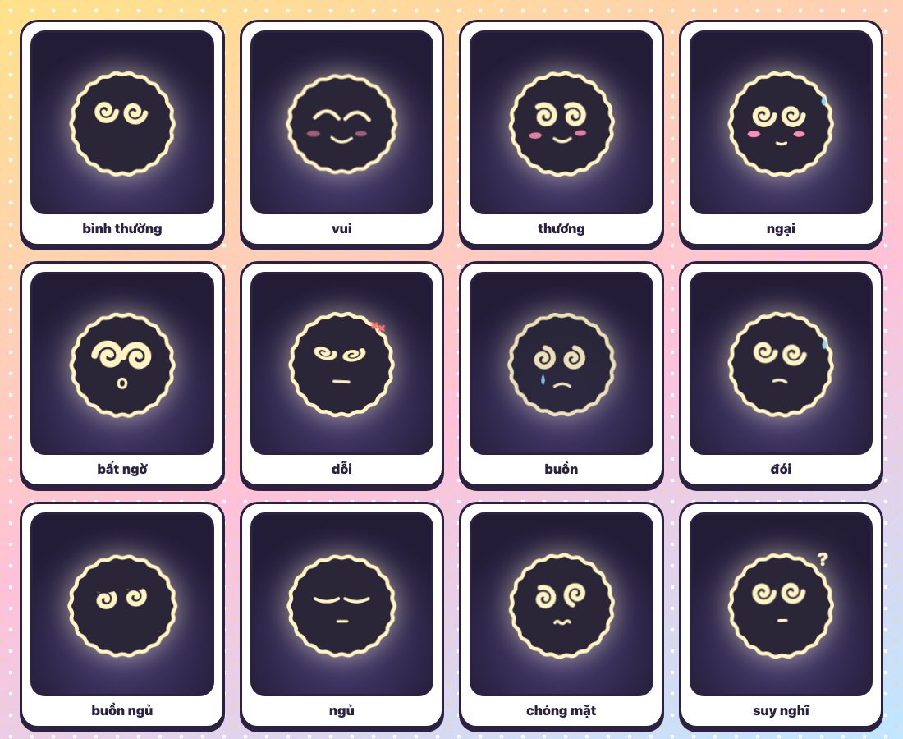

# Dou — bộ 12 gương mặt (chốt 22/11/2026, app v0.1.43)



Mặt bình thường, phóng to: 

## Hình dáng chuẩn

- **Thân:** vòng tròn màu tối `#2a2638`, viền sáng màu phát sáng của từng Dou (mặc định `#fff4c2`), nét mảnh `stroke-width 6`.
- **Lông:** gợn sóng nhỏ và thấp: 22 gợn, biên độ 1.5, bán kính 80 (68 khi còn là trứng).
- **Mắt:** 2 mắt xoáy trôn ốc to bằng nhau, đặt giữa mặt và hơi cao (`ex = 100 ± 23`, `ey = 91`), bán kính 18, nét 8, xoáy 2.75π. Mắt xoay chậm.
- **Không chân mày.** Bản có chân mày cong ôm mắt đã thử và bỏ.
- **Nhìn thẳng**, không đảo mắt qua lại.
- **Chuyển động chung:** cả mặt nghiêng trái/phải ±7°, mỗi vòng 4,5 giây; thân nhún; chớp mắt khoảng 5,5 giây một lần.
- **Phụ kiện theo cấp:** cấp 4 có tay, cấp 5 có vương miện vàng.

## 12 cảm xúc

| Mood (code) | Tên | Mắt | Miệng | Hiệu ứng / chuyển động |
|---|---|---|---|---|
| `idle` | Bình thường | xoáy chậm | không có | nhún nhẹ, nghiêng mặt, chớp mắt |
| `happy` | Vui | cong ^ ^ | cười to | má hồng, nhảy nảy 1,3 giây một nhịp |
| `love` | Thương | xoáy nhanh, đập nhịp | cười | má hồng đậm, lắc lư |
| `shy` | Ngại | xoáy, cúi xuống | cười mỉm nhỏ | má hồng, giọt mồ hôi rơi |
| `surprised` | Bất ngờ | to ra ×1.28, ngừng xoáy | tròn "o" | giật nảy |
| `angry` | Dỗi | nheo dẹt, xếch vào giữa, xoáy ngược | ngang | dấu ✖ đỏ đập nhịp, rung người |
| `sad` | Buồn | xoáy rất chậm, mặt cúi | trễ xuống | nước mắt rơi, thở chậm |
| `hungry` | Đói | xoáy | mếu nhẹ | giọt mồ hôi, lắc lư |
| `sleepy` | Buồn ngủ | mí sụp một nửa | không có | nghiêng chậm như gà gật |
| `sleep` | Ngủ | nhắm cong | ngang nhỏ | "z Z" bay, nền đêm |
| `dizzy` | Chóng mặt | 2 mắt xoáy ngược chiều, rất nhanh | lượn sóng | lắc lư |
| `think` | Suy nghĩ | xoáy | ngang nhỏ | dấu "?" nhún, nghiêng đầu |

Thêm: `learn` (đang học) = mặt suy nghĩ với mắt xoáy nhanh; `hibernate` (ngủ đông) = mặt buồn trên nền đêm.

## Khi nào hiện mặt nào

| Khi | Mặt |
|---|---|
| Bấm vào Dou | ngẫu nhiên vui / thương / ngại / bất ngờ, kéo dài 3,8 giây, kèm 💖 ✨ bay lên |
| Bấm vào Dou 5 lần trong 2,5 giây | chóng mặt, 4,2 giây |
| Dou đang trả lời hoặc chạy script | suy nghĩ |
| Mỗi câu trả lời | Dou tự chọn mood hợp nội dung (trường `mood` của lệnh `reply`), giữ 5 giây |
| Quay lại sau 12 tiếng trở lên | dỗi, giữ đến khi được vuốt ve, lúc đó chuyển sang thương |
| Quay lại sau 7 ngày trở lên (`HIBERNATE_H`) | ngủ đông |
| Chỉ số thấp | đói (no bụng < 35), buồn ngủ (năng lượng < 25) |
| Vui cao | vui (vui > 75) |

## Code ở đâu

- Vẽ: hàm `dou(size, stage, glow)` trong app Dou (`assets/app.html`), trả về SVG với các lớp `.body`, `.face`, `.eyeL`/`.eyeR` (`.eyeb`, `.spin`, `.lid`, `.shut`, `.happyeye`), `.mouth`, `.blush`, `.sweat`, `.tear`, `.vein`, `.qmark`.
- Cảm xúc: class `st-<mood>` trên `#stage`; CSS trong khối "Dou faces" và "no-brow tuning" của `assets/app.html`.
- Miệng: bảng `MOUTH` (path SVG, khung vẽ 220×225):

```js
happy:'M86 128 q15 14 30 0'   love:'M88 128 q13 10 26 0'   sad:'M89 135 q12 -8 24 0'
hungry:'M91 132 q10 -6 20 0'  angry:'M89 132 h24'          surprised: vòng tròn tâm (101,134)
shy:'M94 130 q7 4 14 0'       sleep:'M94 130 h14'          dizzy:'M88 131 q4 -4 8 0 q4 4 8 0 q4 -4 8 0'
think:'M96 131 h12'           learn:'M92 129 q9 6 18 0'
```

- Mood từ AI: enum trong `app.json` (output của `reply`), hướng dẫn chọn mood trong `prompts/reply.md`, lưu vào `turn.mood` ở `backend/main.mjs` (lệnh `record`).
